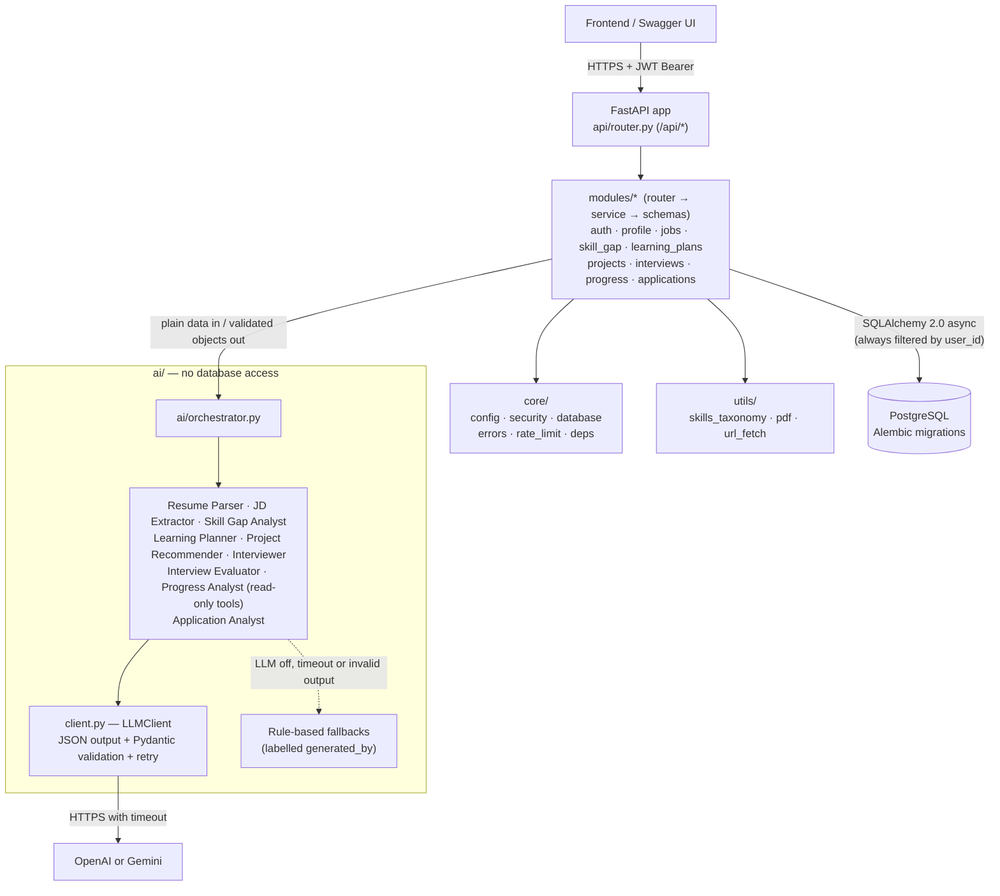
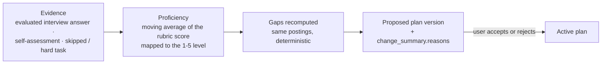
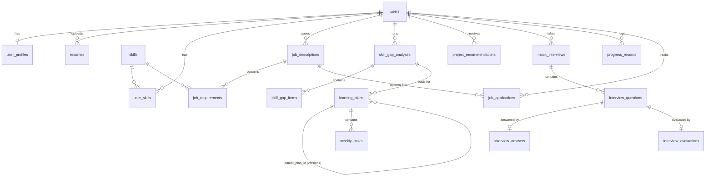

# Architecture

Career Pivot Coach is a **modular monolith**: one FastAPI process, one PostgreSQL database, and business
logic split into feature modules that call each other through plain service functions.

## Key design decisions

| Decision | Why |
|---|---|
| Modular monolith, no microservices | One deploy, one DB transaction boundary, fast to build for a hackathon. Modules can be split later. |
| Models centralised in `app/models/` | Alembic autogenerate sees every table; modules own routers/services/schemas. |
| No repository layer | Services use the SQLAlchemy session directly; an extra layer would add boilerplate without benefit at this size. |
| **AI components never touch the DB** | They receive plain data and return validated Pydantic objects. The LLM cannot run SQL, code, or reach another user's data. |
| **Deterministic core, AI for content** | Gap levels, importance, plan hours, rubric averages and application stats are computed in code. The LLM writes prose/content inside those boundaries. Results are explainable and testable. |
| Every AI output validated + grounded | Pydantic schema validation with one corrective retry. Extracted skills must literally appear in the resume/JD text, plan content must match the computed schedule, projects must cover a real gap. |
| Fallback for every AI feature | `LLM_PROVIDER=none` (or an outage/timeout) still gives a working app. Each record stores `generated_by` (`llm`, `rule_based`, `heuristic_fallback`, `llm_tools`) so users know what produced it. |
| Taxonomy + aliases instead of pgvector | Exact, explainable normalisation ("k8s" → Kubernetes). Related skills only ever give a *partial* match, so semantic closeness never claims a user has a skill. pgvector is a documented future add-on for fuzzy JD search. |
| No Redis | Requests finish synchronously within the LLM timeout. Rate limiting is in-memory (swap to Redis for multi-worker deployments). |
| Versioned learning plans | AI never edits the active plan. Adjustments create a `proposed` version with a `change_summary`; the user accepts or rejects. |
| Tool calling via a JSON step protocol | Works identically for OpenAI and Gemini. The LLM can only call allow-listed, read-only tools over a pre-loaded snapshot of the current user's data, with Pydantic-validated arguments. |

## The closed loop: evidence changes the plan

`modules/progress/adaptation.py` runs after each of those events and never fails the request that triggered it.
It only moves skills the user already has (inventing a level for a missing skill would make it look *less* urgent), drops
skills that are now mastered, adds back skills that fell into the gap, and reuses an identical pending proposal instead of
creating a new one. The active plan is never edited; the reasons are written next to the diff, e.g.
`SQL: average mock-interview score 1.2/10 -> +5.5h (11.0h to 16.5h), starts week 1`.

## Content lives in data files, not code

| File | Used for | What the AI may do with it |
|---|---|---|
| `data/skills_taxonomy.json` | Skill names, synonyms, related skills, learning hours | Nothing: matching is deterministic |
| `data/jds/*.json` | 20 sample postings per role (the fallback when no job-board key is set) | Nothing |
| `data/resources.json` | Free learning resources per skill (URLs were checked when built) | Choose between the listed ids; unknown ids are ignored |
| `data/projects.json` | 31 portfolio project templates tagged with skills | Reword title / description; skills, stack, difficulty and hours are fixed |
| `data/rubric.json` | Interview rubric: 5 dimensions x 5 anchored levels | The prompt is built from it; quotes it returns must appear in the answer |

Skill gaps are aggregated over *all* postings for the target role (importance = the share of postings that mention a skill,
required counting fully, preferred half). Postings are tagged with a role family so that postings for other roles the user
also saved do not dilute the result, and every report records how many postings it used and where they came from.

The application tracker compares each group (channel, role family, seniority, industry, company size, resume version, work
mode, highlighted skill) with all other applications using Wilson 95% intervals. Disjoint intervals are "reliable"; a large
gap with overlapping intervals is an "early signal"; anything else is not mentioned. Applications younger than 14 days with no
reply are left out rather than counted as failures.

## Database relationships

* Every user-owned table has `user_id` (indexed, `ON DELETE CASCADE`), and every query filters by it.
  Accessing another user's record returns **404**, not 403, so IDs can't be probed.
* `skills` is the shared canonical taxonomy (`name`, `slug`, `category`, `in_taxonomy`).
* JSON columns (JSONB on Postgres) hold list-like data that is always read as a whole
  (topics, key points, job references). Anything that's filtered or aggregated is a real column.
* All tables have `created_at` / `updated_at` (timezone-aware).

## Request flow example: `POST /api/skill-gap/analyze`

1. `get_current_user` validates the JWT and loads the user.
2. The service loads only **this user's** job descriptions and skills.
3. `orchestrator.analyze_skill_gaps` → `skill_analyzer.compute_gaps` (deterministic) → optional
   `explain_gaps` (LLM rewrites explanations only; gap levels can't change).
4. The service persists `SkillGapAnalysis` + `SkillGapItem` rows and returns the report.

## Security model

* bcrypt password hashing, HS256 JWT with expiry, secrets only from the environment.
* Uploads: PDF only (extension + content-type + `%PDF-` signature), size and page limits, encrypted PDFs
  rejected, processed in memory (never written to disk), filenames sanitised.
* Prompt injection: untrusted documents are wrapped in delimiters, the system prompt says to treat them as data,
  spoofed delimiters are neutralised, and outputs are validated and grounded regardless.
* URL fetching: http(s) only, public IPs only (SSRF guard), robots.txt respected, no redirects, size cap.
* Errors return a consistent JSON envelope. Unhandled exceptions are logged without request bodies.
* In-memory rate limits on auth and AI-calling endpoints.
